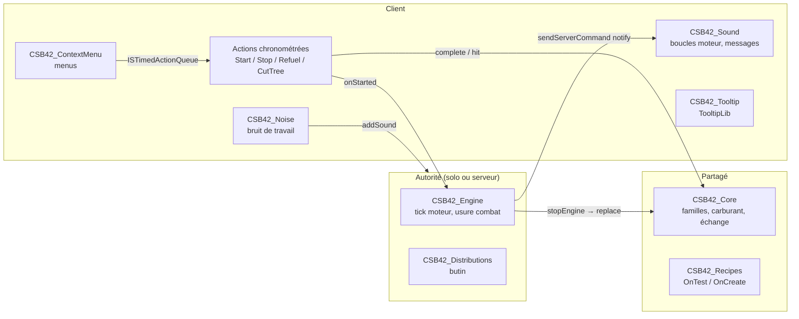

# Architecture — Timber! Chainsaw

Build cible : 42.21. Version des mods : 1.2.0 (`modversion` des deux `mod.info`).

## Vue d'ensemble

Le principe central : **l'état du moteur est le type de l'objet**. `ChainsawB42.ChainsawOff` est une tronçonneuse arrêtée, `ChainsawB42.Chainsaw` une tronçonneuse en marche. Le moteur du jeu donne les animations et l'attaque vanilla de tronçonneuse à un objet dont le type est exactement `Chainsaw` tenu à deux mains (`WeaponType.java:63, 100`, 42.21). Le type étant sauvegardé et synchronisé par le jeu, client et serveur sont toujours d'accord sur les statistiques de l'arme.

Toutes les écritures d'état (échange d'objet, carburant, usure, abattage) se font sur l'**autorité** : le jeu en solo, le serveur en multijoueur. Un client ne fait qu'afficher (menus, sons, infobulle) et émettre le bruit de travail de son propre joueur.



## Arborescence

```
Contents/mods/
├── batman_TimberChainsaw/
│   ├── common/README.txt                  dossier common exigé par la B42 (vide)
│   └── 42.21/
│       ├── mod.info, icon.png, poster.png
│       └── media/
│           ├── AnimSets/player/actions/   CSB42Start.xml, CSB42CutTree.xml
│           ├── AnimSets/player/melee/2handed/  ChainsawDefault.xml, ChainsawMiss.xml (remplacent le vanilla)
│           ├── lua/{shared,client,server}/
│           ├── scripts/                   objets, magazine, modèles, recettes, sons
│           ├── sound/Chainsaw/*.ogg       7 sons (sources CC0, source/build_sounds.py)
│           ├── textures/Item_Chainsaw.png
│           └── sandbox-options.txt
└── batman_TimberAuthenticZCompatibility/  sous-mod facultatif
    ├── common/README.txt
    └── 42.21/
        ├── mod.info
        └── media/
            ├── AnimSets/player/melee/2handed/  copies identiques des deux nœuds Timber
            └── lua/shared/TimberAuthenticZ/TAC_Compatibility.lua
```

Une seule variante (`42.21`) par mod ; `versionMin=42.21`.

### `mod.info`

| Mod | `id` | `require` | `loadModAfter` | `incompatible` |
|---|---|---|---|---|
| Timber! Chainsaw | `batman_TimberChainsaw` | `\TooltipLib` | `\EURY_ITEMINFO` | `\ChainsawB42` |
| Compatibilité Authentic Z | `batman_TimberAuthenticZCompatibility` | `\batman_TimberChainsaw` | `\Authentic Z - Current`, `\AuthenticZLite`, `\Authentic Z - 42.15 FIX`, `\batman_TimberChainsaw` | `\AuthenticZChainsawFix`, `\ChainsawB42` |

Les deux mods sont livrés dans le même objet Workshop (3810638546).

## Modules Lua

Tous les modules partagent la table globale `CSB42` (créée par `CSB42_Core`). Préfixe des messages console : `[CSB42]`.

### `shared`

| Fichier | Responsabilité |
|---|---|
| `ChainsawB42/CSB42_Core.lua` | Constantes (types, capacité 4 L, consommations), registre des **familles** arrêté/en marche (`registerFamily`), lecture des options sandbox avec valeurs par défaut, carburant en ModData, détection d'un bidon d'essence pure, échange d'objet `CSB42.replace` (mains, conteneur, sol), copie d'état (carburant, état proportionnel, réparations, favori, sang, nom personnalisé nettoyé), multiplicateur de dégâts et coût d'endurance, usure fractionnaire des familles de compatibilité, `CSB42.notify`. |
| `ChainsawB42/CSB42_Recipes.lua` | `CSB42_Recipes.canRepair` (OnTest) et `CSB42_Recipes.onRepair` (OnCreate) de la recette `RepairChainsaw`. |
| `TimedActions/CSB42_StartAction.lua` | Démarrage : animation `CSB42Start`, son, raté éventuel, échange vers le type en marche dans `complete()`, enregistrement auprès du moteur. |
| `TimedActions/CSB42_StopAction.lua` | Arrêt : son, `CSB42.stopEngine` dans `complete()`. |
| `TimedActions/CSB42_RefuelAction.lua` | Plein depuis un récipient d'essence pure, quantité manquante seulement, dans `complete()`. |
| `TimedActions/CSB42_CutTreeAction.lua` | Abattage : coups toutes les 0,4 s sur l'autorité (minuterie `update()` en solo, `emulateAnimEvent` sur le serveur), `toppleTree`, carburant et usure. |

### `client`

| Fichier | Responsabilité |
|---|---|
| `ChainsawB42/CSB42_ContextMenu.lua` | Menus d'inventaire et du monde : démarrer, arrêter, faire le plein, abattre l'arbre ; options grisées avec infobulle de raison. |
| `ChainsawB42/CSB42_Sound.lua` | Boucles moteur jouées localement pour chaque joueur proche (≤ 40 cases) tenant une tronçonneuse en marche : ralenti, plein régime en attaque, coupe de bois si un arbre est devant ; volume aligné sur le curseur « Effets sonores » ; réception de la commande `notify` et texte au-dessus du joueur (le serveur dédié ne charge pas `media/lua/client`). |
| `ChainsawB42/CSB42_Noise.lua` | Bruit de travail (`NoiseWorking`) émis par le client du joueur local qui attaque ou abat un arbre, toutes les 2 s. Retour immédiat si `isServer()`. |
| `ChainsawB42/CSB42_Tooltip.lua` | Lignes d'infobulle via TooltipLib : état du moteur, jauge et litres. |

### `server`

| Fichier | Responsabilité |
|---|---|
| `ChainsawB42/CSB42_Engine.lua` | Retour immédiat si `isClient()`. Table des moteurs en marche ; à chaque `OnTick` : consommation au ralenti, bruit `NoiseIdle`, synchronisation du carburant, arrêt automatique ; arrêt des tronçonneuses en marche non enregistrées (rechargement, reconnexion après 5 s) ; usure au combat (`OnZombieDead`) ; carburant de coupe des attaques sur un arbre (`OnWeaponHitTree`). Définit `CSB42.onStarted` et `CSB42.stopEngine`. |
| `Items/CSB42_Distributions.lua` | Poids de butin de la tronçonneuse (×`LootChance`/3) et du magazine dans `ProceduralDistributions` (`OnPreDistributionMerge`, puis `OnInitGlobalModData` + `ItemPickerJava.Parse()` si l'option diffère). |

Le dossier `server` est aussi chargé en solo : l'autorité solo exécute donc le moteur. Les actions partagées testent l'existence de `CSB42.stopEngine`/`CSB42.onStarted` avant de les appeler (absentes sur un client MP).

### Dépendances `require`

- Tous les fichiers : `ChainsawB42/CSB42_Core`.
- Actions : `TimedActions/ISBaseTimedAction`.
- Menus : les quatre actions.
- Infobulle : `TooltipLib/Core` (mod requis ; sans lui, message console et aucune ligne).
- Distributions : `Items/ProceduralDistributions`.
- Compatibilité Authentic Z : `ChainsawB42/CSB42_Core` (erreur explicite si `CSB42.registerFamily` est absent).

## Flux et autorité

| Flux | Où | Mécanisme |
|---|---|---|
| Démarrer / arrêter / faire le plein / abattre | client → autorité | Actions chronométrées B42 : `isValid()` côté client, `complete()` (ou `animEvent` pour la coupe) sur l'autorité. Le serveur n'appelle jamais `isValid()` (`NetTimedAction.java:119-122`) : `complete()` revérifie tout. |
| Échange d'objet | autorité | `CSB42.replace` : retrait/ajout dans le conteneur avec `sendRemoveItemFromContainer`/`sendAddItemToContainer`, au sol avec `transmitRemoveItemFromSquare` + `AddWorldInventoryItem`, mains avec `sendEquip`. |
| Carburant | autorité → propriétaire | ModData, `syncItemFields()` tous les 0,05 L consommés, après un plein, une réparation, une usure. |
| Usure | autorité | `OnZombieDead` (attaquant tenant une tronçonneuse en marche), coups d'abattage (1 chance sur 8). |
| Messages | autorité → propriétaire | `sendServerCommand(player, "ChainsawB42", "notify", { key, playerOnlineId })` ; en solo appel direct de `CSB42.showNotice`. |
| Bruit au ralenti | autorité | `addSound` toutes les 2 s (`NoiseIdle`). |
| Bruit de travail | client du joueur | `addSound` toutes les 2 s (`NoiseWorking`), envoyé au serveur par le jeu ; seul le client local connaît son attaque (`isAttacking`). |
| Son du moteur | chaque client | Boucle locale déduite de l'objet tenu (synchronisé par le jeu) ; aucun message réseau. |
| Dégâts au combat | moteur du jeu | Arme vanilla de type `Chainsaw` ; `MinDamage`/`MaxDamage` multipliés par `DamageMod` au démarrage (sauvegardés avec l'objet). |
| Endurance | chaque machine | `EnduranceMod` du script × `EnduranceCost` réappliqué tant que l'objet est tenu (`HandWeapon.save` ne l'écrit pas). |

Il n'y a **aucune** commande `sendClientCommand` : toutes les demandes du client passent par les actions chronométrées réseau du jeu.

## Persistance

- **ModData d'objet** (tronçonneuses Timber) : `CurrentFuel`, `FuelCapacity` à la racine, mêmes clés que le mod d'origine Chainsaw B42 (le carburant d'une ancienne sauvegarde est conservé). Absentes = réservoir plein.
- **ModData d'objet** (familles Authentic Z) : sous-table `batman_TimberAuthenticZCompatibility` (`CurrentFuel`, `FuelCapacity`, `wearRemainder`). Les anciennes clés racine sont lues sans être modifiées.
- **Type d'objet** : l'état du moteur. Un `Chainsaw` trouvé tenu sans avoir été démarré dans la session (rechargement, reconnexion) est remis à `ChainsawOff` : les moteurs ne survivent pas à un rechargement.
- **Nom personnalisé** : copié sans les préfixes d'état (`Bloody`, `Worn`…) figés par les versions ≤ 1.1.0, nettoyés à la copie suivante.
- Aucune ModData globale, aucun fichier.

Détails des formats : [specifications-techniques.md](specifications-techniques.md#clés-moddata).

## Points d'extension et intégrations

- **`CSB42.registerFamily{ off, running, dataKey?, keepDamage?, prepareRunning? }`** : enregistre une paire d'objets existants arrêté/en marche d'un autre mod. Utilisé par le sous-mod Authentic Z (`AuthenticZClothing.*`, `AuthenticZLite.*`). Contrat : [specifications-techniques.md](specifications-techniques.md#api-lua-publique).
- **TooltipLib** (requis) : fournisseur `batman_TimberChainsaw`.
- **Better Item Info** (`EURY_ITEMINFO`, facultatif) : `loadModAfter` pour l'ordre des infobulles.
- **Fichiers d'animation** `ChainsawDefault.xml`/`ChainsawMiss.xml` : remplacent les fichiers vanilla de même chemin ; le sous-mod Authentic Z en livre des copies identiques pour passer devant ceux d'Authentic Z (contrôle d'égalité dans `tests/run_tests.py`).

## Outillage

- `tests/run_tests.py [--require-luacheck]` : luacheck (`.luacheckrc`), syntaxe Lua 5.1, absence de `next()`, traductions (JSON, mêmes clés et paramètres que EN, `%` seul interdit), clés utilisées par le code, descriptions Steam (≤ 8 000 octets, BBCode, liens, caractères perdus, `workshop.txt` = `README.steam`), nœuds d'animation, tests Lua `tests/lua/test_*.lua` sous `lupa` avec l'API simulée `tests/lua/game_api.lua`.
- CI : `.github/workflows/checks.yml` (Ubuntu 24.04, Python 3.12, `lua-check`, `lupa`) à chaque push et pull request.
- `source/build_translations.py` : **génère** les fichiers `Translate/<LANGUE>/*.json` (10 langues) ; modifier les textes ici puis régénérer.
- `source/build_sounds.py` : fabrique les `.ogg` depuis les enregistrements CC0 BigSoundBank (0707, 0982, 0983).
