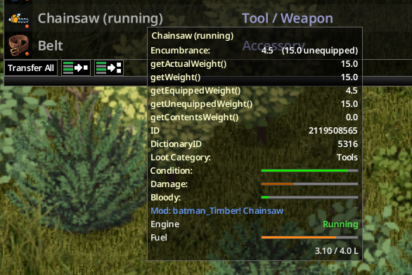

# Fuel and maintenance

[Home](Home.md) · Previous: [Using the chainsaw](02-using-the-chainsaw.md) · Next: [Felling trees](04-felling-trees.md) · [Français](../fr/03-fuel-and-maintenance.md)

## Tank and consumption

- The tank holds **4 L**. A new chainsaw is full.
- Idling, a full tank lasts about **16 minutes** of real time at game speed ×1. Consumption follows game time: fast-forward burns faster.
- Cutting trees burns extra fuel: about 0.45 L more for the biggest tree.
- The tooltip shows the engine state and the fuel left.

> Capture à faire : the 1.2.0 tooltip outside debug mode (this screenshot comes from an older version, weight 15).

## Refuel

1. Stop the chainsaw.
2. Carry a container of **pure petrol** (bags you carry count).
3. Right-click the chainsaw: **Refuel the chainsaw**.

Only the missing litres are taken, from the fullest petrol container. Any other liquid, or petrol mixed with something else, is refused ("Needs a container of pure petrol in your inventory."). Walking cancels the action.

> Capture à faire : the "Refuel the chainsaw" option with a petrol can in the inventory.

## Wear

- Combat: 20 condition points per zombie killed (option).
- Trees: 1 point, one chance in 8 per cut (option).
- A broken chainsaw stops and cannot start until it is repaired.

## Repair

Recipe **Repair Chainsaw**, learned from the magazine, Mechanics 3, on any surface:

- the stopped chainsaw (a broken one is accepted);
- 2 engine parts, 2 electronics scrap, 2 scrap metal, 4 screws, 1 blowtorch;
- a screwdriver and a wrench (kept).

The chainsaw comes back at full condition, with its fuel and its name. An undamaged chainsaw cannot be repaired; repairs are unlimited. Gives 20 Mechanics XP.

## Craft

Recipe **Forge Chainsaw**, learned from the magazine, Blacksmithing 5 and Welding 3, at a primitive forge: 4 sheet metal, 2 small metal sheets, 5 engine parts, 5 electronics scrap, 2 wire, 2 metal pipes, 10 screws, 5 charcoal, 2 blowtorches, 1 heavy chain; a hammer, pliers or tongs, and a welding mask (kept).

The magazine **Small Engine Repair & Maintenance** teaches both recipes.

## Where to find one

- Chainsaws (1 to 3 % per roll): logging sites, ranger stations, fire stations, barns, garages, farms, mechanics, tool stores, garden stores, tool crates.
- The magazine: logging sites, ranger stations, car supply stores, tool stores, mechanics, bookstores, magazine racks, libraries.
