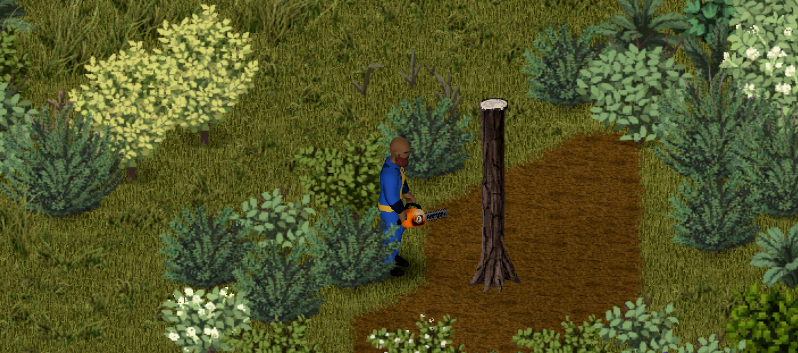
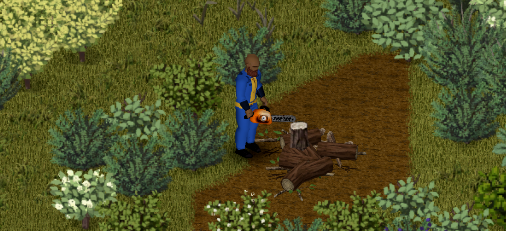

# Felling trees

[Home](Home.md) · Previous: [Fuel and maintenance](03-fuel-and-maintenance.md) · Next: [Sandbox options](05-sandbox-options.md) · [Français](../fr/04-felling-trees.md)

## Cut down a tree

1. [Start the chainsaw](02-using-the-chainsaw.md#start) and keep it in both hands.
2. Right-click a tree: **Cut down the tree with the chainsaw**.
3. Your character walks next to the tree and cuts until it falls.

At default speed the chainsaw removes 50 tree points per second: a small tree (40 to 160 points) falls in 1 to 3 seconds, the biggest (560 points) in about 11 seconds. The tree falls and leaves its logs, like a tree chopped with an axe.

Cutting stops when you walk away, the tank runs dry or the chainsaw breaks.

## Attacking a tree

Holding the attack button in front of a tree also damages it and burns the same extra fuel. You then hear the wood-cutting sound instead of the free revs.

## Cost

- Extra fuel per tree point: about 0.45 L for the biggest tree, on top of idling.
- Wear: 1 point, one chance in 8 per cut (2.5 cuts per second).
- Noise: 40 tiles every 2 seconds while cutting.

Speed, fuel and wear are [sandbox options](05-sandbox-options.md).
