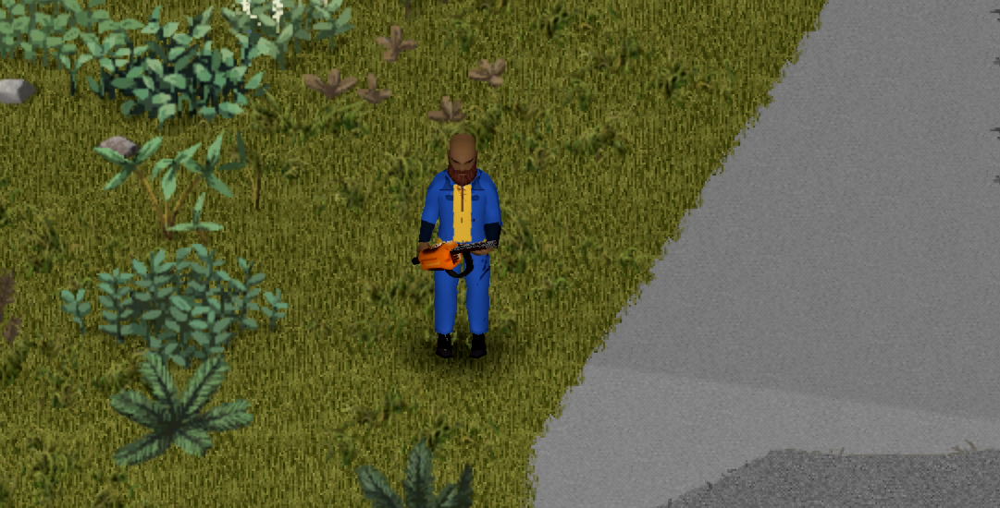

# Utiliser la tronçonneuse

[Accueil](Home.md) · Précédent : [Installation](01-installation.md) · Suivant : [Carburant et entretien](03-fuel-and-maintenance.md) · [English](../en/02-using-the-chainsaw.md)

## Deux états

| Objet | Moteur | Au combat |
|---|---|---|
| **Tronçonneuse** | arrêté | une massue lourde et faible (0,1 à 0,5 de dégâts) |
| **Tronçonneuse (en marche)** | en marche | 1,2 à 2,4 de dégâts, 25 % de coups critiques |

Les deux pèsent **7** et ont **127** points d'état. C'est une arme à deux mains.

## Démarrer

1. Clic droit sur la tronçonneuse dans l'inventaire (ou n'importe où dans le monde quand vous la tenez) : **Démarrer la tronçonneuse**.
2. Elle est prise à deux mains si besoin, puis le personnage tire sur le lanceur.

L'option est grisée, avec la raison en infobulle, si la tronçonneuse est cassée, si le réservoir est vide ou si vous êtes dans un véhicule.

**Ratés** : sous la moitié de son état, une tronçonneuse a 25 % de chances (option) de ne pas démarrer (« *Toussotement* La tronçonneuse ne démarre pas... »). Réessayez, ou réparez-la.

> Capture à faire : le menu contextuel avec « Démarrer la tronçonneuse ».

## Combattre

- Visez avec le bouton droit et attaquez avec le bouton gauche, comme avec toute arme de mêlée.
- Bouton d'attaque maintenu : la lame reste pointée devant vous, à plein régime, et frappe ce qui se trouve devant toutes les 0,67 s.
- Chaque zombie tué coûte 20 points d'état (option). Le coût en endurance vaut la moitié de celui d'une arme normale de 7 kg (option).
- La tronçonneuse ne renverse pas les zombies.

> Capture à faire : une tronçonneuse en marche qui découpe un zombie.

## Arrêter

Clic droit : **Arrêter la tronçonneuse**. Le moteur s'arrête aussi tout seul quand :

- la tronçonneuse quitte vos mains (rangée dans un sac, un meuble, posée au sol) ;
- le réservoir est vide (« La tronçonneuse n'a plus d'essence ») ou elle casse (« La tronçonneuse a cassé ») ;
- vous montez dans un véhicule ou mourez ;
- vous rechargez la partie ou vous reconnectez : les moteurs ne survivent pas à un rechargement.

Le démarrage et l'arrêt conservent le carburant, l'état, le nombre de réparations, le favori, le sang et le nom personnalisé.

## Bruit

Un moteur en marche attire les zombies : un bruit de 20 cases toutes les 2 secondes au ralenti, et de 40 cases pendant une attaque ou un abattage (options).
